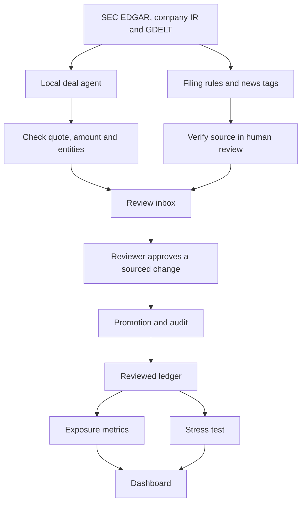

# Round-Trip AI

**How much of an AI supplier's backlog comes from customers it helped finance?** Across 38 reviewed relationships, the central estimate is **$46.7 billion out of $2.72 trillion, or 1.72%**. The lower and upper financing assumptions give **1.39% to 18.22%** against the same backlog denominator. The evidence snapshot is October 5, 2026.

A seller can invest in a customer that then contracts to buy its chips or cloud capacity. This project follows both payments. Its local deal agent reads filings and company releases, proposes who pays whom, quotes the evidence and sends each proposal to a reviewer. Only reviewed ledger entries contribute to the dashboard.

> **Start here**
>
> **60 seconds** · Read the headline above and follow the [system diagram](#how-the-system-works).
>
> **5 minutes** · Open **How it works** on the dashboard. Follow the [interview walkthrough](docs/WALKTHROUGH.md#five-minutes) from one disclosure to the review decision.
>
> **Deep dive** · Follow the [numbered reading order](docs/README.md) from source data to evaluation and design decisions.

The largest uncertainty is disclosure. Filings identify a customer for only 20.7% of the $2.72 trillion denominator. A zero measured relationship can mean the counterparty was never named.

## How the system works



Open the combined worklist with `python -m deal_agent inbox`. Filing and news candidates live in CSV. Agent proposals live in SQLite and carry machine verification and repair history. Both routes require a human decision.

## Run it

From a full Git checkout, use Python 3.12 and GNU Make. Install once in an isolated environment. The refresh parity test also reads an earlier Git commit. Install Node.js to include the browser/Python stress parity tests.

```bash
python3.12 -m venv .venv
. .venv/bin/activate
make setup
make demo
make explain ID=a_81cddd0804260229a87a
make serve
```

Open [the How it works panel](http://localhost:8765/#how). The dashboard files are bundled. Demo, explain, inbox, tests and serving work offline after setup. The demo uses a temporary queue and the saved Qwen recording. It shows the 2019 OpenAI release, the failed amount-text check and the unsuccessful repair.

| Task | Requirements |
|---|---|
| See pending evidence | `python -m deal_agent inbox` prints the inspection command for each candidate. |
| Rebuild financial outputs | `python -m deal_agent publish` computes from the local reviewed ledger. |
| Run the local model | Start Ollama and download the desired weights. `python -m deal_agent run --source news` reads the stored corpus and leaves proposals pending. |
| Update the public sources | Copy `.env.example` to `.env`, set your SEC contact locally, then run `make refresh`. This fetches filings and news and rebuilds the snapshot. |

One reviewed example illustrates why review matters. Microsoft disclosed $13 billion of total funding commitments to OpenAI. The demo finds an older $1 billion announcement. Adding both without checking whether the total includes the earlier investment could double count it. [Microsoft filing](https://www.sec.gov/Archives/edgar/data/789019/000119312525256321/msft-20250930.htm)

### Other targets

| target | what it does |
|---|---|
| `make ingest` | SEC submissions, XBRL company facts, filing documents, all cached |
| `make extract` | regenerate `ledger/candidates.csv` from cached filing text |
| `make build` | compute exposure metrics into `outputs/` and `site/data/` |
| `make stress` | cascade, Monte Carlo, cross-check methods, tornado |
| `make news` | EDGAR 8-K items, IR feeds, GDELT; tag and deduplicate |
| `make test` | the test suite |
| `make audit` | re-verify a random sample of ledger rows against their sources |
| `make serve` | serve the static dashboard |

## What is in here

```
ledger/        edges.csv, backlog.csv, nodes.csv, candidates.csv, snapshots/
src/           the pipeline: ingest, extract, review, metrics, stress, news, refresh
site/          the static dashboard: index.html, app.js, cascade.js, vendor/
tests/         toy-graph correctness, direction, tiers, parity, rate limiter
outputs/       metrics.json, stress.json, coverage.md, audit.md, changelog.md
docs/          METHODOLOGY.md
DECISIONS.md   pre-registered metric definitions, then every judgement call since
STATE.md       what is done, what is next, known issues
```

## How a number becomes a number

1. **Ingest.** SEC EDGAR only, with a declared User-Agent, five requests per
   second, disk cache, retries with exponential backoff.
2. **Extract.** Rules and regex find dollar amounts near counterparty names and
   financing verbs. These are **candidates**, written to
   `ledger/candidates.csv`. They count toward nothing.
3. **Review.** A human reads the source and promotes the supported ones.
   The optional agent has a separate SQLite review queue, described below:

   ```bash
   python -m src.review list                 # pending queue, largest first
   python -m src.review show c_abc123        # the full context window
   python -m src.review promote c_abc123 \
       --quote "verbatim text from the filing, under 25 words" \
       --edge-type equity_investment --status conditional \
       --amount-low 0 --amount-high 5000000000
   python -m src.review reject c_abc123 --reason "false positive, capex guidance"
   python -m src.review batch ledger/promotions.yaml   # a reviewed batch
   python -m src.review verify                          # validate the ledger
   ```

   The command refuses a promotion without a quote, refuses a quote of 25 words
   or more, refuses a T1 row without an accession number, and refuses T4
   evidence outright. `tests/test_no_autopromote.py` parses `src/extract.py` to
   confirm it can never write to the ledger.

4. **Compute.** `src/metrics.py` builds the backlog dependency matrix, the
   funding provenance readings and the structure analysis. `src/stress.py` runs
   the cascade, the Monte Carlo and two cross-check methods.
5. **Publish.** `src/site_data.py` writes the JSON the dashboard reads. Every
   figure on the page resolves to the ledger rows that produced it, with a
   source link, a verbatim quote and an as-of date.

## Serving the dashboard

`make serve` serves `site/` locally. A static host can serve that same directory. A GitHub Pages deployment would need to publish the contents of `site/` through a Pages workflow or a supported publishing source.

### Optional daily refresh

`.github/workflows/refresh.yml` runs `make refresh` on a cron and commits the
updated data. It is **disabled by default**: the `schedule` trigger is commented
out and it only runs on manual dispatch. To enable it, uncomment the schedule
block and add a repository secret `SEC_USER_AGENT` with your contact string.
It runs inside the GitHub Actions free tier.

## What this cannot tell you

* **Most of the backlog has no name on it.** 79.3% of the disclosed backlog
  here is owed by customers no filing identifies. Broadcom and Oracle name no
  customer at all. Their exposure is unmeasurable, not low, and the dashboard
  says so rather than printing a zero and moving on.
* **Private labs file nothing.** OpenAI, Anthropic and xAI publish no periodic
  reports. Every number touching them comes from a counterparty or their own
  press release and is reported as a range.
* **Some real instruments have no dollar figure.** AMD's warrants to OpenAI and
  Meta are 160 million shares each at a cent, with no value disclosed. The
  Broadcom gigawatt agreements with OpenAI and Anthropic carry no dollars. These
  are in the ledger at zero and contribute nothing to the dollar-weighted
  readings.
* **The two companies most associated with vendor financing cannot be measured.**
  Nvidia and AMD sell on purchase orders and disclose no product backlog, so
  there is no denominator for them. They carry no headline number here.
* **The stress result is assumption-dominated.** The widest parameter swing is
  larger than half the base result. Pass-through alone is worth 5.9 percentage
  points. Treat the stress numbers as a structured way to reason about the
  shape of a shock, not as a forecast.
* **This is analysis, not investment advice.** No price targets, no
  recommendations, no view on any security.

## Honesty rules this project runs on

1. Nothing enters the ledger from memory. Every edge has a source URL, and a
   quote, and an accession number if it is an SEC filing. Background knowledge
   decides what to look for; it is never evidence.
2. The headline admits SEC filings and company releases only. Media reports
   appear in a separate labelled view. Rumour is never counted.
3. Binding and non-binding are distinguished, and conditional money is never
   counted at full weight by default.
4. Private companies are reported as ranges, never point estimates.
5. Every figure links to the rows that generate it and shows its as-of date.
6. The dashboard states what it cannot see, in specifics, on the front page.

## Licence and data

Code is yours to use. The data is public: SEC EDGAR filings, company press
releases and GDELT metadata. Only headlines, links, dates, publishers and short
snippets are stored from news sources; article bodies are never fetched.
