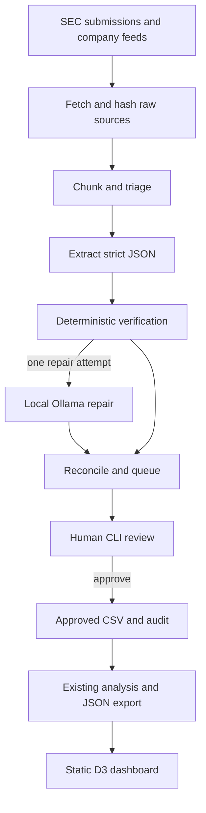

# Round-Trip AI: Who Is Financing Their Own Customers?

A living research dashboard that quantifies how much AI infrastructure supplier
backlog depends on counterparties whose funding traces back to the supplier,
stress tests that dependency, and refreshes itself as new filings and news
arrive.

Everything runs locally and for free. SEC EDGAR, company investor-relations
feeds and GDELT. No paid APIs. The default refresh uses rules; the optional
`deal_agent` extractor uses a downloaded model on local Ollama, behind human review.

## The headline

> Roughly **1.7%** (range 1.4% to 18.2%) of disclosed backlog depends on a
> counterparty whose funding traces back to the seller.

That figure is computed over the **20.7%** of this backlog universe that any
filing ties to a named customer. The other **79.3%** names nobody, so the
headline is a floor on what is visible, not a measurement of what exists. Oracle
alone discloses $664 billion of remaining performance obligations and names no
customer anywhere in its filings.

As of 2026-10-05, from 38 verified ledger edges: 28 from SEC filings, 10 from
company releases, none from media reports or rumour.

## Run it

```bash
make setup                 # install dependencies
cp .env.example .env       # then put your own name and email in it
make refresh               # ingest, extract, tag news, rebuild, snapshot, diff
make serve                 # dashboard at http://localhost:8765
```

`SEC_USER_AGENT` must be set to a real contact string of the form
`Name email@domain`, which is what the SEC requires of automated clients. The
pipeline hard-fails with a clear message if it is missing or a placeholder.

A full `make refresh` from a cold cache takes about fifteen minutes, most of it
downloading filings at the SEC's five-requests-per-second limit. Afterwards the
cache makes it far quicker.

### Other targets

| target | what it does |
|---|---|
| `make ingest` | SEC submissions, XBRL company facts, filing documents, all cached |
| `make extract` | regenerate `ledger/candidates.csv` from cached filing text |
| `make build` | compute exposure metrics into `outputs/` and `site/data/` |
| `make stress` | cascade, Monte Carlo, cross-check methods, tornado |
| `make news` | EDGAR 8-K items, IR feeds, GDELT; tag and deduplicate |
| `make test` | the test suite |
| `make audit` | re-verify a random sample of ledger rows against their sources |
| `make serve` | serve the static dashboard |

## What is in here

```
ledger/        edges.csv, backlog.csv, nodes.csv, candidates.csv, snapshots/
src/           the pipeline: ingest, extract, review, metrics, stress, news, refresh
site/          the static dashboard: index.html, app.js, cascade.js, vendor/
tests/         toy-graph correctness, direction, tiers, parity, rate limiter
outputs/       metrics.json, stress.json, coverage.md, audit.md, changelog.md
docs/          METHODOLOGY.md
DECISIONS.md   pre-registered metric definitions, then every judgement call since
STATE.md       what is done, what is next, known issues
```

## How a number becomes a number

1. **Ingest.** SEC EDGAR only, with a declared User-Agent, five requests per
   second, disk cache, retries with exponential backoff.
2. **Extract.** Rules and regex find dollar amounts near counterparty names and
   financing verbs. These are **candidates**, written to
   `ledger/candidates.csv`. They count toward nothing.
3. **Review.** A human reads the source and promotes the supported ones.
   The optional agent has a separate SQLite review queue, described below:

   ```bash
   python -m src.review list                 # pending queue, largest first
   python -m src.review show c_abc123        # the full context window
   python -m src.review promote c_abc123 \
       --quote "verbatim text from the filing, under 25 words" \
       --edge-type equity_investment --status conditional \
       --amount-low 0 --amount-high 5000000000
   python -m src.review reject c_abc123 --reason "false positive, capex guidance"
   python -m src.review batch ledger/promotions.yaml   # a reviewed batch
   python -m src.review verify                          # validate the ledger
   ```

   The command refuses a promotion without a quote, refuses a quote of 25 words
   or more, refuses a T1 row without an accession number, and refuses T4
   evidence outright. `tests/test_no_autopromote.py` parses `src/extract.py` to
   confirm it can never write to the ledger.

4. **Compute.** `src/metrics.py` builds the backlog dependency matrix, the
   funding provenance readings and the structure analysis. `src/stress.py` runs
   the cascade, the Monte Carlo and two cross-check methods.
5. **Publish.** `src/site_data.py` writes the JSON the dashboard reads. Every
   figure on the page resolves to the ledger rows that produced it, with a
   source link, a verbatim quote and an as-of date.

## Deploying free on GitHub Pages

The dashboard is a static directory with no build step and no runtime
dependencies beyond a locally vendored copy of D3.

1. Push the repository to GitHub.
2. Settings, Pages, Source: **Deploy from a branch**. Branch `main`,
   folder `/site`.
3. The dashboard appears at `https://<user>.github.io/<repo>/`.

`site/data/*.json` is committed, so Pages serves the latest numbers without
running anything. To keep it current, enable the daily workflow below.

### Optional daily refresh

`.github/workflows/refresh.yml` runs `make refresh` on a cron and commits the
updated data. It is **disabled by default**: the `schedule` trigger is commented
out and it only runs on manual dispatch. To enable it, uncomment the schedule
block and add a repository secret `SEC_USER_AGENT` with your contact string.
It runs inside the GitHub Actions free tier.

## What this cannot tell you

* **Most of the backlog has no name on it.** 79.3% of the disclosed backlog
  here is owed by customers no filing identifies. Broadcom and Oracle name no
  customer at all. Their exposure is unmeasurable, not low, and the dashboard
  says so rather than printing a zero and moving on.
* **Private labs file nothing.** OpenAI, Anthropic and xAI publish no periodic
  reports. Every number touching them comes from a counterparty or their own
  press release and is reported as a range.
* **Some real instruments have no dollar figure.** AMD's warrants to OpenAI and
  Meta are 160 million shares each at a cent, with no value disclosed. The
  Broadcom gigawatt agreements with OpenAI and Anthropic carry no dollars. These
  are in the ledger at zero and contribute nothing to the dollar-weighted
  readings.
* **The two companies most associated with vendor financing cannot be measured.**
  Nvidia and AMD sell on purchase orders and disclose no product backlog, so
  there is no denominator for them. They carry no headline number here.
* **The stress result is assumption-dominated.** The widest parameter swing is
  larger than half the base result. Pass-through alone is worth 5.9 percentage
  points. Treat the stress numbers as a structured way to reason about the
  shape of a shock, not as a forecast.
* **This is analysis, not investment advice.** No price targets, no
  recommendations, no view on any security.

## Honesty rules this project runs on

1. Nothing enters the ledger from memory. Every edge has a source URL, and a
   quote, and an accession number if it is an SEC filing. Background knowledge
   decides what to look for; it is never evidence.
2. The headline admits SEC filings and company releases only. Media reports
   appear in a separate labelled view. Rumour is never counted.
3. Binding and non-binding are distinguished, and conditional money is never
   counted at full weight by default.
4. Private companies are reported as ranges, never point estimates.
5. Every figure links to the rows that generate it and shows its as-of date.
6. The dashboard states what it cannot see, in specifics, on the front page.

## Licence and data

Code is yours to use. The data is public: SEC EDGAR filings, company press
releases and GDELT metadata. Only headlines, links, dates, publishers and short
snippets are stored from news sources; article bodies are never fetched.


## Local deal extraction agent

### Repository inspection and integration

This is a Python research pipeline with a static HTML/CSS/JavaScript dashboard
and vendored D3, not a Python web app. Canonical nodes are the existing display
names in `ledger/nodes.csv`; the directed, approved graph is `ledger/edges.csv`.
`src/site_data.py` exports it to `site/data/ledger.json`; `site/app.js` fetches
that JSON alongside the existing metrics, stress, news and history payloads.
The agent preserves the CSV ledger, legacy edge taxonomy, legal-status weights,
amount ranges, metric definitions and dashboard layout. New optional CSV columns
retain the richer extraction schema. The initial migration changes no original
field or financial value. Older CSVs still load, and unknown extra columns survive
ledger I/O. Existing `make refresh` remains rules-only.

The new package is `deal_agent/`. Its loop is plain Python, with one module per
responsibility and a small `Provider` protocol; only Ollama is implemented.
`config.yaml` remains the single configuration file (new `deal_agent` section).
No API keys, paid data, hosted model or framework for agents is required.



### Setup in VS Code

Use Python 3.12. Install [Ollama](https://ollama.com/download), open this repository
in VS Code, and run in its terminal:

```bash
python3 -m venv .venv
source .venv/bin/activate
python -m pip install -r requirements.txt
ollama pull qwen2.5:7b-instruct
```

Start `ollama serve` in another terminal if the Ollama desktop app is not already
serving. Windows: activate with `.venv\Scripts\Activate.ps1` instead. Model download
and subsequent inference are local and free; the 7B model can be slow on a CPU.
For extraction/eval alone, `requirements-agent.txt` is the smaller runtime;
review/publication also needs the existing analytical dependencies.

Set `SEC_USER_AGENT` in your environment or an uncommitted `.env` to **your real
name/application description plus your real contact email**, separated by a space.
The fetcher rejects missing or placeholder contacts; no email is embedded in code.
The SEC's [public submissions API](https://www.sec.gov/search-filings/edgar-application-programming-interfaces)
needs no API key. Its [fair-access policy](https://www.sec.gov/about/developer-resources)
limits aggregate traffic to 10 requests/second. The agent uses the stricter of the
configured SEC limit and a 0.25-second polite interval by default, including
retries and redirects. Run only one SEC-fetching command at a time; the SEC limit
is per user across machines, and the local lock cannot coordinate separate hosts.

Edit only `config.yaml` to change the public-company watchlist, aliases, feeds,
model, chunking or thresholds. CIKs come from the existing nodes table, and unknown
entities are flagged rather than added. Google resolves to the existing Alphabet
node. RSS/Atom URLs are intentionally empty by default, with commented publisher
examples; add only company newsroom/IR feeds whose full releases may be retrieved.
The old news monitor's GDELT metadata path does not feed article bodies to the agent.

### Commands and an end-to-end check

```bash
python -m pytest tests -q                  # local fixtures; no LLM or network
python -m deal_agent eval --validate-only  # schema, hashes and expected evidence
python -m deal_agent eval                  # saved gold texts + local Ollama only
python -m deal_agent run                   # fetch -> propose; never publish
python -m deal_agent runs                  # counts and verification rate for last run
python -m deal_agent review                # interactive approve/edit/reject/skip
python -m deal_agent review list
python -m deal_agent publish               # retry/rebuild approved data, no network
make serve                                # http://localhost:8765
```

An offline smoke check that creates a real pending review from an attributed
local excerpt, without contacting the SEC:

```bash
python -m deal_agent import-file eval/gold/texts/nvidia_openai_2025.txt \
  --company Nvidia --date 2025-09-22 \
  --source-url https://nvidianews.nvidia.com/news/openai-and-nvidia-announce-strategic-partnership-to-deploy-10gw-of-nvidia-systems
python -m deal_agent run --no-fetch
python -m deal_agent run --no-fetch         # zero new candidates on the second run
python -m deal_agent review list
python -m deal_agent runs
```

This is already a ledger deal, so expect DUPLICATE or an ambiguity warning from
legacy pending copies, not a new financial finding. Inspect the source, then reject
the smoke candidate or explicitly update the corresponding ledger row. Import does
not approve anything. For live smoke runs, reduce `max_documents_per_run` and narrow
the watchlist in YAML first. `run --no-sec` polls only configured feeds.

All commands accept `--config PATH` **before** the command; relative paths inside
that YAML resolve from its containing directory. Publication requires the existing
project layout: configuration beside `src/` and the graph at `ledger/edges.csv`;
custom graph paths can be used for extraction experiments with `--no-publish`. `run --no-fetch` processes cached
sources only. First runs start at `initial_since`; later submissions scans overlap
the last successful discovery date. Historical submissions shards are included if
they intersect that window. Document and EX-99.1 discovery jobs are stored before
the cursor advances, so failed downloads are retried even after a later scan.
Primary URLs are fetched once; source bytes and extracted text carry SHA-256 hashes.
Identical text under another URL shares processing, while source metadata and raw
hashes remain recorded separately. Successful chunks are cached; unfinished chunks
retry. A processed document is not re-extracted merely because the model/config
changes; use eval or a separate state database to compare a changed configuration.

### Human review and publication

SQLite (`data/deal_agent/queue.sqlite3`) is used instead of another CSV queue for
unique document/candidate keys, chunk checkpoints, atomic status changes, recovery
and queryable audit events. The existing two CSV queues are read for reconciliation
and remain separate. Every extracted candidate, including failed verification and
DUPLICATE classifications, starts **pending** and contributes nothing to metrics.
Candidates and rejected decisions persist across runs. The database, raw files and
full traces are local and gitignored: back up `data/deal_agent/` if you need portable
review history. Do not delete it to refresh the graph.

Review displays the quote, source link, deterministic results and reconciliation
explanation, then asks for a short publication quote, legal status and dollar bounds.
The complete evidence remains on the candidate and in the optional CSV metadata.
The existing publication quote must remain 1–24 words, T1 requires an accession,
T4 is prohibited, and both endpoints must resolve to existing nodes. A failed
verification cannot be approved: edit it and recheck, or reject it. Review checks
stored text hashes before using evidence. Low model confidence is a warning, not
a reason to discard a candidate.

Noninteractive examples (replace the example ids with real queue/ledger ids):

```bash
python -m deal_agent review show CANDIDATE_ID --json /tmp/deal-edit.json
# Edit /tmp/deal-edit.json in VS Code. It contains Deal fields, not queue metadata.
python -m deal_agent review edit CANDIDATE_ID --json /tmp/deal-edit.json \
  --actor "David Gold" --reason "Corrected payer after reading the contract"
python -m deal_agent review reject CANDIDATE_ID --actor "David Gold" \
  --reason "Duplicate of an already reviewed announcement"
python -m deal_agent review approve CANDIDATE_ID --actor "David Gold" \
  --quote "NVIDIA intends to invest up to $100 billion in OpenAI progressively as each gigawatt is deployed." \
  --status LOI_nonbinding --amount-low 0 --amount-high 100000000000 \
  --reason "Read original release; contingent nonbinding investment cap" \
  --target-edge nvidia__openai__equity_investment__20250922
python -m deal_agent review audit
```

The approval example works only when that exact short quote is present in the
candidate evidence; select a substring of the actual displayed evidence. Nothing
is promoted by copying an example. Dollar bounds cannot exceed the verified amount;
an unknown amount stays `[0,0]` with undisclosed metadata until an edit establishes
USD evidence. Decide conservative private-company ranges explicitly. Choose
`--basis per-year` only with `--term-start` and `--term-end`; otherwise preserve the
quoted contract-value basis. These choices affect the existing metrics.

NEW does not imply a match was proven absent: same-pair, different-date contracts
are kept separate, and multiple plausible matches are shown as ambiguous. UPDATE
is suggested only for a unique compatible date/source identity or explicit expansion
with a unique antecedent in the configured window. An expansion could be incremental
or cumulative; the agent never adds amounts. Approval of UPDATE/DUPLICATE requires
an explicit `--target-edge` or `--new-edge` and a reason. Updates replace that exact
row while preserving its stable id; before/after values live in immutable audit
payloads, avoiding double-counting both old and revised values. Existing snapshots
retain historical data. Matching a pending item does not publish it indirectly. An explicitly separate
same-day contract with a colliding legacy id receives a stable candidate-id suffix.

Approval records actor, UTC time, original candidate, chosen row, reconciliation
and file hashes before an atomic CSV replacement. A prepared audit event recovers
a crash between CSV replacement and queue status update. A conflicting later file
edit stops recovery for manual inspection. Default reviewer identity is the local
OS username; use `--actor` to record your chosen name. Local identity is attribution,
not authentication. Locks prevent concurrent agent runs and concurrent approvals;
do not concurrently write the CSV with the legacy review CLI or an editor. A stale
lock after a crash must be removed only after confirming the owning process stopped.

After approval, the CLI runs the original offline refresh path with ingestion,
news and rules extraction skipped. The ledger, metric, stress and history payloads and snapshots use approved
financial rows only; the existing news monitor remains independent. A failed rebuild leaves the
approved ledger/audit intact and instructs `publish` to retry. Use `--no-publish`
for a batch and publish once afterwards. No dashboard redesign or public review
view is added: this is a static hosted site, while pending source text, model output
and review actions belong on the local machine. The CLI provides the review UI.

The richer deal types map to the legacy taxonomy only at approval:

| Extracted deal_type | Published edge_type default |
|---|---|
| equity_investment | equity_investment |
| compute_purchase_commitment | cloud_capacity_contract |
| chip_purchase | purchase_commitment |
| cloud_services_contract | cloud_capacity_contract |
| debt_or_loan | convertible_or_debt |
| gpu_backed_financing | vendor_financing |
| warrants_or_options | warrants |
| revenue_share / other | Analyst must select an existing type with --edge-type |

The original `deal_type` is retained even when an analyst chooses another legacy
mapping. This keeps the pre-registered funding/demand families and JavaScript/Python
stress parity intact rather than quietly assigning a novel instrument to demand.

### Traces, evaluation results and limitations

Every model request/response, HTTP attempt, graph read, verification, reconciliation,
proposal and approval has JSONL events under `data/deal_agent/traces/`: run id,
stage, inputs, outputs, latency and model (null for non-LLM tools). Prompts are
versioned in `deal_agent/prompts/v1/`; their hashes are logged. Tool results may
reference local raw/text artifacts by hash to avoid copying entire filings into
every trace event. The model gets untrusted text and a schema; it has no browser,
shell, Python execution or publication tools. Loopback endpoints are enforced and
cloud model tags rejected. There is no hosted-model fallback.

`eval/gold/` holds **12 positive and 5 negative excerpts**, source URLs, dates,
SHA-256s and strict expected edges. **Seven labels are explicitly uncertain** in
`manifest.json`: investment instrument for Microsoft 2023, Nvidia/OpenAI and the
two Amazon tranches; payer/demand interpretation for the two Oracle arrangements;
and Nvidia/CoreWeave's residual-capacity contract classification/date. Check those
sources before treating their types as definitive. Precise amounts are not inferred
from vague multi-billion-dollar descriptions, gigawatts or share counts. The
negative set includes safety commitments, benchmark participation and open-source
users. These are span-level labels, not assertions that every sentence in the linked
full article contains no deal. Explicit publisher-context headers resolve first-person
references; headers are not evidence quotes.

See [`eval/VALIDATION.md`](eval/VALIDATION.md) for deterministic corpus checks and
[`eval/RESULTS.md`](eval/RESULTS.md) for the actual benchmark attempt. All expected
edges validate mechanically. **Model precision/recall and amount accuracy are not
yet measured**: the implementation environment has no running Ollama model. The
report records the failed local connection, withholds accuracy, and exits nonzero.
It does not substitute hand-written predictions for model output. The pytest
providers are mocks used to validate control flow and scoring only.

Run `python -m deal_agent eval` after pulling the configured model. It uses local
source files and loopback inference only, a separate temporary database, no SEC
contact and no production queue. Results go to `eval/results/latest.md` and JSON
with per-document predictions, errors, model/config, corpus and prompt hashes.
`--exclude-uncertain` reports the smaller subset; results must state whether those
labels were included. The harness reports triage precision/recall, directed
pair+type edge precision/recall with one-to-one matching, matched-edge amount
accuracy (and numeric-only accuracy), and final verification pass rate. Failed
verification predictions still count. Any model execution error marks a run
incomplete and withholds metrics. `--validate-only` uses no model and is not an
accuracy benchmark.

Remaining limits: short excerpts are an initial smoke set, not a statistically
powered or held-out full-filing benchmark. Several negatives are easy keyword
rejections; add hard negatives, longer filings, new dates, and adjudicated labels
before quoting model quality in a portfolio. Mechanical checks establish quotation
and explicit USD presence, not direction, legal status, incrementality, correct
attribution of one of several dollar figures, or whether an exercise price is a
deal value. Those require human judgment. Filer/publisher metadata supplies first-person company context; mention detection
can still miss long-distance or other pronoun references, RSS dates can be crawl dates, and a completed immutable
URL is not refetched to detect a publisher rewriting it. SEC foreign-issuer forms,
PDFs and agreement exhibits other than EX-99.1 are outside this extractor's current
scope. Metadata URLs/feeds are polled each run; already stored document URLs are
not downloaded again. Rate limiting is local to this command, not distributed.

### One-command local benchmark
Run `ollama pull qwen2.5:7b-instruct`, start Ollama, then `make agent-bench`.
Compare two pulled models: `make agent-bench AGENT_BENCH_ARGS="--models qwen2.5:7b-instruct llama3.1:8b"`.
The command checks availability, records live calls, scores rules, and writes `eval/RESULTS.md`.
Keep `eval/cassettes/` recordings to reproduce live runs offline with `eval --provider replay --cassette PATH`.
