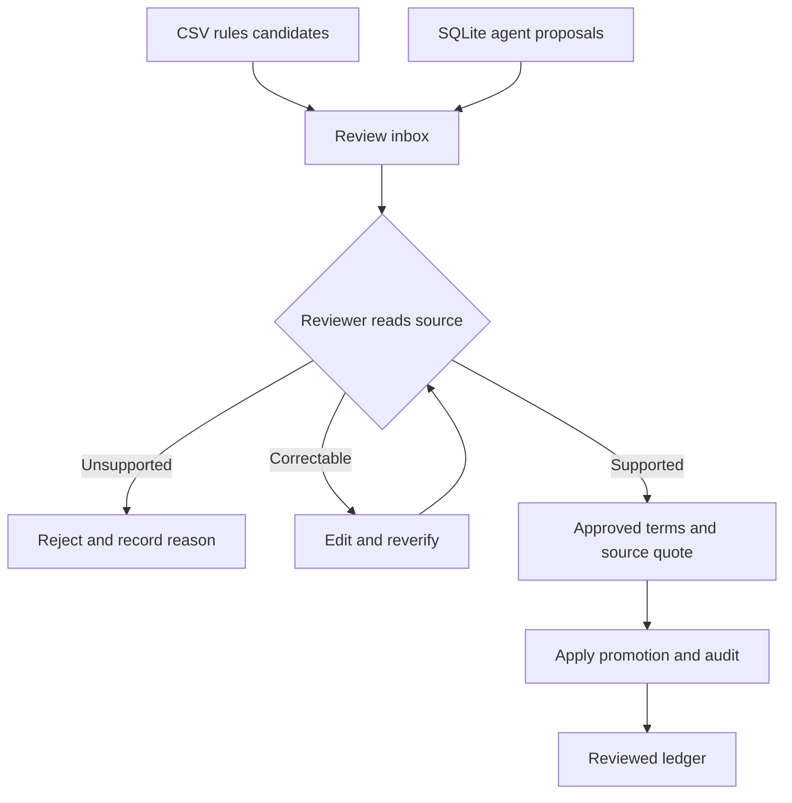

# Data and ledger

## Review and promotion

## The ledger

One row per directed edge, with a source URL, a verbatim quote under 25 words,
and an SEC accession number on every T1 row. Direction is money-flow: the arrow
starts at whoever pays. Funding edges run funder to recipient, purchase and
capacity edges run buyer to seller. A round trip is therefore a two-cycle, which
`tests/test_direction.py` asserts.

Nothing enters the ledger automatically. `src/extract.py` writes candidates only,
and `tests/test_no_autopromote.py` parses its source to confirm the module never
references `edges.csv`. Promotion is `python -m src.review`, which refuses a
promotion without a quote, refuses a T1 row without an accession number, and
refuses T4 evidence outright.

## Evidence tiers

| tier | meaning | headline | sensitivity view |
|---|---|---|---|
| T1 | SEC filing | yes | yes |
| T2 | company release or IR page | yes | yes |
| T3 | reputable media report | no | yes, labelled |
| T4 | unverified or rumour | never | never |

The filing index records accessions and cache paths. News storage preserves the original URL and snippet, which may be the only available text. Read the [ledger schema](../ledger/SCHEMA.md) and the [review commands](04-deal-agent.md#human-review-and-publication) before changing a row.
