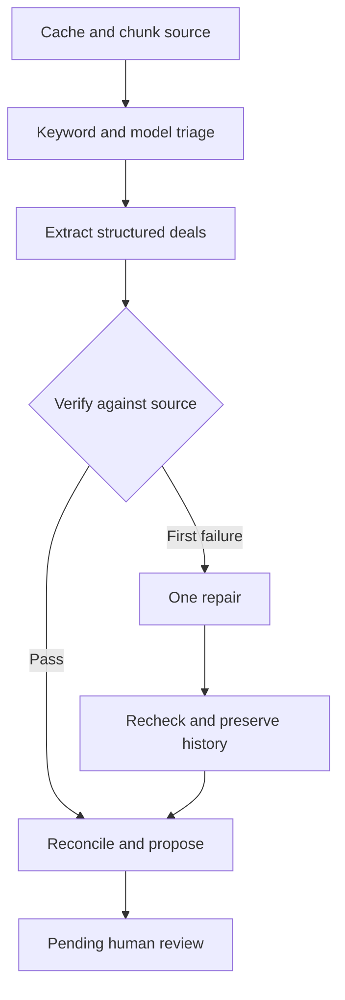

# Deal agent

## Proposal workflow



## Setup

Use Python 3.12. Install [Ollama](https://ollama.com/download), open this repository
in VS Code, and run in its terminal:

```bash
python3 -m venv .venv
source .venv/bin/activate
python -m pip install -r requirements.txt
ollama pull qwen2.5:7b-instruct
```

Start `ollama serve` in another terminal if the Ollama desktop app is not already
serving. Windows: activate with `.venv\Scripts\Activate.ps1` instead. Model download
and subsequent inference are local and free; the 7B model can be slow on a CPU.
For extraction/eval alone, `requirements-agent.txt` is the smaller runtime;
review/publication also needs the existing analytical dependencies.

Set `SEC_USER_AGENT` in your environment or an uncommitted `.env` to **your real
name/application description plus your real contact email**, separated by a space.
The fetcher rejects missing or placeholder contacts; no email is embedded in code.
The SEC's [public submissions API](https://www.sec.gov/search-filings/edgar-application-programming-interfaces)
needs no API key. Its [fair-access policy](https://www.sec.gov/about/developer-resources)
limits aggregate traffic to 10 requests/second. The agent uses the stricter of the
configured SEC limit and a 0.25-second polite interval by default, including
retries and redirects. Run only one SEC-fetching command at a time; the SEC limit
is per user across machines, and the local lock cannot coordinate separate hosts.

Edit only `config.yaml` to change the public-company watchlist, aliases, feeds,
model, chunking or thresholds. CIKs come from the existing nodes table, and unknown
entities are flagged rather than added. Google resolves to the existing Alphabet
node. RSS/Atom URLs are intentionally empty by default, with commented publisher
examples; add only company newsroom/IR feeds whose full releases may be retrieved.
The old news monitor's GDELT metadata path does not feed article bodies to the agent.

## Operations

```bash
python -m pytest tests -q                  # local fixtures; no LLM or network
python -m deal_agent eval --validate-only  # schema, hashes and expected evidence
python -m deal_agent eval                  # saved gold texts + local Ollama only
python -m deal_agent run                   # stored news if present; fallback fetch; propose only
python -m deal_agent runs                  # counts and verification rate for last run
python -m deal_agent review                # approve exports YAML; edit/reject/skip
python -m deal_agent review list
python -m deal_agent publish               # retry/rebuild approved data, no network
make serve                                # http://localhost:8765
```

An offline smoke check that creates a real pending review from an attributed
local excerpt, without contacting the SEC:

```bash
python -m deal_agent import-file eval/gold/texts/nvidia_openai_2025.txt \
  --company Nvidia --date 2025-09-22 \
  --source-url https://nvidianews.nvidia.com/news/openai-and-nvidia-announce-strategic-partnership-to-deploy-10gw-of-nvidia-systems
python -m deal_agent run --no-fetch
python -m deal_agent run --no-fetch         # zero new candidates on the second run
python -m deal_agent review list
python -m deal_agent runs
```

This is already a ledger deal, so expect DUPLICATE or an ambiguity warning from
legacy pending copies, not a new financial finding. Inspect the source, then reject
the smoke candidate or explicitly update the corresponding ledger row. Import does
not approve anything. For live smoke runs, reduce `max_documents_per_run` and narrow
the watchlist in YAML first. `run --source fetch --no-sec` polls only configured feeds. `run --source news`
reuses original ingestion; snippets are not full article bodies. Original feed dates
may be crawl dates and must be checked before choosing a publication date.

All commands accept `--config PATH` **before** the command; relative paths inside
that YAML resolve from its containing directory. Publication requires the existing
project layout: configuration beside `src/` and the graph at `ledger/edges.csv`;
custom graph paths can be used for extraction and approval-export experiments. `run --no-fetch` processes cached
sources only. First runs start at `initial_since`; later submissions scans overlap
the last successful discovery date. Historical submissions shards are included if
they intersect that window. Document and EX-99.1 discovery jobs are stored before
the cursor advances, so failed downloads are retried even after a later scan.
Primary URLs are fetched once; source bytes and extracted text carry SHA-256 hashes.
Identical text under another URL shares processing, while source metadata and raw
hashes remain recorded separately. Successful chunks are cached; unfinished chunks
retry. A processed document is not re-extracted merely because the model/config
changes; use eval or a separate state database to compare a changed configuration.

## Human review and publication

The agent queue stores extraction and verification history. All ledger changes
use the project's existing promotions mechanism. No model writes the ledger.

1. Run `python -m deal_agent review list` and inspect a candidate with
   `python -m deal_agent review show ID`.
2. Run `python -m deal_agent review --actor analyst` for interactive
   edit/reject/approve. Read the original source and choose the publication quote,
   legal status, amount bounds and rationale. Approval exports a YAML and records
   its path in the immutable review audit. It does not change the ledger.
3. Inspect that YAML, then run `python -m src.review batch PATH_PRINTED_BY_REVIEW`.
   This is the original promotion path. It records an application event in
   `ledger/promotion_audit.jsonl`. Keep the reviewed YAML with your promotion
   history and audit; do not edit its guard fields or approved edge.
4. Run `python -m deal_agent publish` to rebuild metrics, stress and dashboard.
   This rebuild uses the reviewed ledger and performs no model extraction.

An approved SQLite status means reviewed/exported, not published. An UPDATE
requires an explicit existing edge id, and the original promotion mechanism
updates that row rather than appending a second copy. Distinct same-day contracts
require an explicit NEW decision and receive stable distinct edge ids.

If the ledger changed before application, batch refuses the stale review.
Use `python -m deal_agent review reopen ID --actor analyst --reason "..."`,
then review the candidate again. A new revision preserves the old YAML and audit.
An applied approval cannot be reopened; a later restatement needs a new reviewed
candidate. Failed verification requires an edit and successful recheck first.
Rich extraction metadata remains in SQLite audit; promotion rows use the original
ledger fields. Existing filing/news queues and promotion files are unchanged.

Noninteractive review actions are also available:

```bash
python -m deal_agent review show CANDIDATE_ID --json /tmp/deal-edit.json
python -m deal_agent review edit CANDIDATE_ID --json /tmp/deal-edit.json --actor analyst --reason "Corrected payer from source"
python -m deal_agent review reject CANDIDATE_ID --actor analyst --reason "Already reviewed"
python -m deal_agent review audit
```

The publication quote must be a verbatim substring of verified evidence and 1 to
24 words. T1 requires an accession, T4 is prohibited, and endpoints must resolve
to existing nodes. Unknown USD remains `[0,0]`; finite bounds cannot exceed the
verified disclosed amount. Use `--basis per-year` only with explicit term dates.
Review must establish legal status, conditions, amount basis and announcement date.
Local reviewer identity is attribution, not authentication. Do not concurrently
edit the ledger or run separate review processes; inspect stale locks before removal.

NEW is a proposal, not proof no related arrangement exists. UPDATE/DUPLICATE need
an explicit `--target-edge` or `--new-edge` decision and rationale. The agent never
adds an expansion to an old amount automatically. Read whether the source gives
incremental or cumulative terms. Same-day distinct contracts receive stable suffixes.

The richer deal types map to the legacy taxonomy only at approval:

| Extracted deal_type | Published edge_type default |
|---|---|
| equity_investment | equity_investment |
| compute_purchase_commitment | cloud_capacity_contract |
| chip_purchase | purchase_commitment |
| cloud_services_contract | cloud_capacity_contract |
| debt_or_loan | convertible_or_debt |
| gpu_backed_financing | vendor_financing |
| warrants_or_options | warrants |
| revenue_share / other | Analyst must select an existing type with --edge-type |

The richer type and consideration remain in the immutable approval audit. The
standard promotions row uses the original ledger fields; legacy funding/demand
families and browser/Python stress parity are preserved.

## Feedback from a decision

1. An approval or rejection records its source, evidence, reason and any edit in the SQLite audit.
2. Review projects eligible decisions into `data/deal_agent/reviewed-examples.jsonl`.
3. When review restarts it repairs the file from applied audit events without duplicating examples.
4. A reopened approval becomes ineligible until the next decision. Read the latest state with `current_examples`.
5. Frozen test URLs, source hashes and exact evidence quotes are excluded. Eligible examples can be curated for future development runs.

SQLite keeps chunk checkpoints by document. Retain the local state directory when updating the branch. For a new configuration, benchmark in the isolated evaluator. The read-only News panel shows recent proposals after `python -m deal_agent export-pending`. For offline rehearsal use `make demo`. [Evaluation and recordings](05-evaluation.md).
