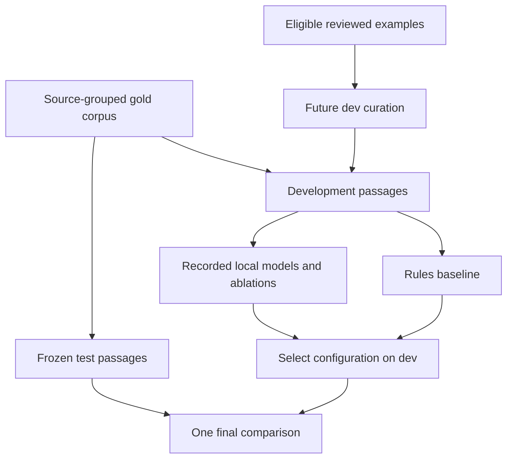

# Evaluation

## How an experiment runs



## Design and interpretation

There are 25 small, attributed passages. Fifteen are for development (ten positive, five negative). Ten are frozen for test (seven positive, three negative). Five disputed document labels remain, including two on test. The inclusive comparison keeps them. Same-source excerpts stay together. The original rules baseline had already been scored on all passages before this split. The holdout protects subsequent choices and cannot establish performance on future filings.

For each document, match the directed canonical payer, recipient and exact extracted type one-to-one. An extra prediction counts as a false positive even when verification failed. A missing gold relationship is a false negative. Amount agreement is conditional on a matched edge, with tolerance of the greater of $1 and 0.1% of its labeled amount. Interpret any percentage with its count.

Rules preserve the original $50 million floor, verb priority and guessed direction. Ollama receives the saved source, public metadata and schema. Labels stay in the scorer. The published tables link each configuration to a run and recording. The corpus lacks full-length filing examples. Multiple excerpts from a single deal can remain correlated inside one partition.

Record/replay is explicit and never falls back to the network:

```bash
python -m deal_agent eval --provider record --cassette eval/cassettes/my-run.json
python -m deal_agent eval --provider replay --cassette eval/cassettes/my-run.json
```

Recording refuses to overwrite a cassette. Live files retain exact requests,
schema, model/options, raw Ollama response metadata, generated text and errors.
Replay refuses changed requests or settings. Real recordings are committable;
review their public-source content before sharing. Synthetic fixtures are clearly
flagged, and their metrics are always withheld. Keep the same corpus and prompts
when reproducing a live run. Detailed reports/traces remain under `eval/results/`.


## Run locally

```bash
python -m deal_agent eval --validate-only
make agent-bench AGENT_BENCH_ARGS="--models qwen2.5:7b-instruct llama3.1:8b --prompt-versions v1 v2"
```

Use dev for new comparisons. Read the [published results](../eval/RESULTS.md), [gold source notes](../eval/gold/README.md), [freeze](../eval/gold/splits.json) and [selection rule](history/NIGHT3.md#selection-rule-recorded-before-scoring).

An interrupted development benchmark can continue with the same arguments plus `--resume TIMESTAMP`, using the directory name under `eval/results/`. Matching completed configurations are reused. An unfinished configuration replays its exact successful prefix, then records fresh local calls. Timing includes the recorded inference duration for reused calls. A changed request or an error in the prefix stops recovery.
