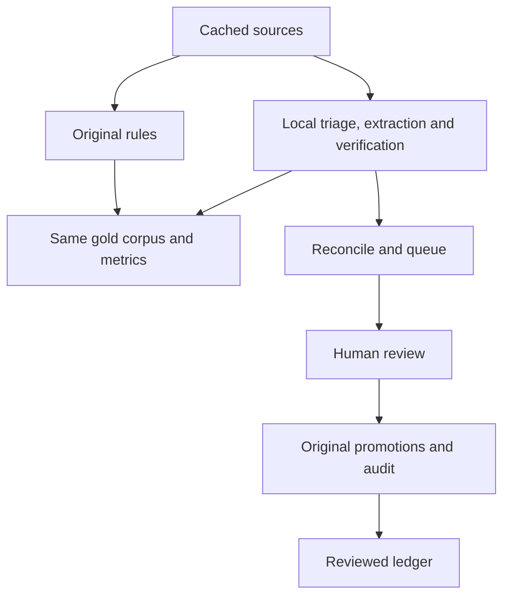

# Deal agent


### Repository inspection and integration

This is a Python research pipeline with a static HTML/CSS/JavaScript dashboard
and vendored D3, not a Python web app. Canonical nodes are the existing display
names in `ledger/nodes.csv`; the directed, approved graph is `ledger/edges.csv`.
`src/site_data.py` exports it to `site/data/ledger.json`; `site/app.js` fetches
that JSON alongside the existing metrics, stress, news and history payloads.
The agent preserves the CSV ledger, legacy edge taxonomy, legal-status weights,
amount ranges, metric definitions and dashboard layout. New optional CSV columns
retain the richer extraction schema. The initial migration changes no original
field or financial value. Older CSVs still load, and unknown extra columns survive
ledger I/O. Existing `make refresh` remains rules-only.

The new package is `deal_agent/`. Its loop is plain Python, with one module per
responsibility and a small `Provider` protocol; Ollama is the only live model backend.
`config.yaml` remains the single configuration file (new `deal_agent` section).
No API keys, paid data, hosted model or framework for agents is required.



### Setup in VS Code

Use Python 3.12. Install [Ollama](https://ollama.com/download), open this repository
in VS Code, and run in its terminal:

```bash
python3 -m venv .venv
source .venv/bin/activate
python -m pip install -r requirements.txt
ollama pull qwen2.5:7b-instruct
```

Start `ollama serve` in another terminal if the Ollama desktop app is not already
serving. Windows: activate with `.venv\Scripts\Activate.ps1` instead. Model download
and subsequent inference are local and free; the 7B model can be slow on a CPU.
For extraction/eval alone, `requirements-agent.txt` is the smaller runtime;
review/publication also needs the existing analytical dependencies.

Set `SEC_USER_AGENT` in your environment or an uncommitted `.env` to **your real
name/application description plus your real contact email**, separated by a space.
The fetcher rejects missing or placeholder contacts; no email is embedded in code.
The SEC's [public submissions API](https://www.sec.gov/search-filings/edgar-application-programming-interfaces)
needs no API key. Its [fair-access policy](https://www.sec.gov/about/developer-resources)
limits aggregate traffic to 10 requests/second. The agent uses the stricter of the
configured SEC limit and a 0.25-second polite interval by default, including
retries and redirects. Run only one SEC-fetching command at a time; the SEC limit
is per user across machines, and the local lock cannot coordinate separate hosts.

Edit only `config.yaml` to change the public-company watchlist, aliases, feeds,
model, chunking or thresholds. CIKs come from the existing nodes table, and unknown
entities are flagged rather than added. Google resolves to the existing Alphabet
node. RSS/Atom URLs are intentionally empty by default, with commented publisher
examples; add only company newsroom/IR feeds whose full releases may be retrieved.
The old news monitor's GDELT metadata path does not feed article bodies to the agent.

### Commands and an end-to-end check

```bash
python -m pytest tests -q                  # local fixtures; no LLM or network
python -m deal_agent eval --validate-only  # schema, hashes and expected evidence
python -m deal_agent eval                  # saved gold texts + local Ollama only
python -m deal_agent run                   # stored news if present; fallback fetch; propose only
python -m deal_agent runs                  # counts and verification rate for last run
python -m deal_agent review                # approve exports YAML; edit/reject/skip
python -m deal_agent review list
python -m deal_agent publish               # retry/rebuild approved data, no network
make serve                                # http://localhost:8765
```

An offline smoke check that creates a real pending review from an attributed
local excerpt, without contacting the SEC:

```bash
python -m deal_agent import-file eval/gold/texts/nvidia_openai_2025.txt \
  --company Nvidia --date 2025-09-22 \
  --source-url https://nvidianews.nvidia.com/news/openai-and-nvidia-announce-strategic-partnership-to-deploy-10gw-of-nvidia-systems
python -m deal_agent run --no-fetch
python -m deal_agent run --no-fetch         # zero new candidates on the second run
python -m deal_agent review list
python -m deal_agent runs
```

This is already a ledger deal, so expect DUPLICATE or an ambiguity warning from
legacy pending copies, not a new financial finding. Inspect the source, then reject
the smoke candidate or explicitly update the corresponding ledger row. Import does
not approve anything. For live smoke runs, reduce `max_documents_per_run` and narrow
the watchlist in YAML first. `run --source fetch --no-sec` polls only configured feeds. `run --source news`
reuses original ingestion; snippets are not full article bodies. Original feed dates
may be crawl dates and must be checked before choosing a publication date.

All commands accept `--config PATH` **before** the command; relative paths inside
that YAML resolve from its containing directory. Publication requires the existing
project layout: configuration beside `src/` and the graph at `ledger/edges.csv`;
custom graph paths can be used for extraction and approval-export experiments. `run --no-fetch` processes cached
sources only. First runs start at `initial_since`; later submissions scans overlap
the last successful discovery date. Historical submissions shards are included if
they intersect that window. Document and EX-99.1 discovery jobs are stored before
the cursor advances, so failed downloads are retried even after a later scan.
Primary URLs are fetched once; source bytes and extracted text carry SHA-256 hashes.
Identical text under another URL shares processing, while source metadata and raw
hashes remain recorded separately. Successful chunks are cached; unfinished chunks
retry. A processed document is not re-extracted merely because the model/config
changes; use eval or a separate state database to compare a changed configuration.

### Human review and publication

SQLite stores unique source/candidate identities, chunk checkpoints, verification
history and immutable review audits. Filing/news CSV queues remain available for
reconciliation. Every proposal starts pending, including failed verification and
DUPLICATE cases; it contributes nothing to metrics. Back up `data/deal_agent/` to
preserve local review history and sources. Never delete it to refresh the graph.

The agent queue stores extraction and verification history. All ledger changes
use the project's existing promotions mechanism. No model writes the ledger.

1. Run `python -m deal_agent review list` and inspect a candidate with
   `python -m deal_agent review show ID`.
2. Run `python -m deal_agent review --actor "David Gold"` for interactive
   edit/reject/approve. Read the original source and choose the publication quote,
   legal status, amount bounds and rationale. Approval exports a YAML and records
   its path in the immutable review audit. It does not change the ledger.
3. Inspect that YAML, then run `python -m src.review batch PATH_PRINTED_BY_REVIEW`.
   This is the original promotion path. It records an application event in
   `ledger/promotion_audit.jsonl`. Keep the reviewed YAML with your promotion
   history and audit; do not edit its guard fields or approved edge.
4. Run `python -m deal_agent publish` to rebuild metrics, stress and dashboard.
   This rebuild uses the reviewed ledger and performs no model extraction.

An approved SQLite status means reviewed/exported, not published. An UPDATE
requires an explicit existing edge id, and the original promotion mechanism
updates that row rather than appending a second copy. Distinct same-day contracts
require an explicit NEW decision and receive stable distinct edge ids.

If the ledger changed before application, batch refuses the stale review.
Use `python -m deal_agent review reopen ID --actor "David Gold" --reason "..."`,
then review the candidate again. A new revision preserves the old YAML and audit.
An applied approval cannot be reopened; a later restatement needs a new reviewed
candidate. Failed verification requires an edit and successful recheck first.
Rich extraction metadata remains in SQLite audit; promotion rows use the original
ledger fields. Existing filing/news queues and promotion files are unchanged.

Noninteractive review actions are also available:

```bash
python -m deal_agent review show CANDIDATE_ID --json /tmp/deal-edit.json
python -m deal_agent review edit CANDIDATE_ID --json /tmp/deal-edit.json --actor "David Gold" --reason "Corrected payer from source"
python -m deal_agent review reject CANDIDATE_ID --actor "David Gold" --reason "Already reviewed"
python -m deal_agent review audit
```

The publication quote must be a verbatim substring of verified evidence and 1 to
24 words. T1 requires an accession, T4 is prohibited, and endpoints must resolve
to existing nodes. Unknown USD remains `[0,0]`; finite bounds cannot exceed the
verified disclosed amount. Use `--basis per-year` only with explicit term dates.
Review must establish legal status, conditions, amount basis and announcement date.
Local reviewer identity is attribution, not authentication. Do not concurrently
edit the ledger or run separate review processes; inspect stale locks before removal.

NEW is a proposal, not proof no related arrangement exists. UPDATE/DUPLICATE need
an explicit `--target-edge` or `--new-edge` decision and rationale. The agent never
adds an expansion to an old amount automatically. Read whether the source gives
incremental or cumulative terms. Same-day distinct contracts receive stable suffixes.

The richer deal types map to the legacy taxonomy only at approval:

| Extracted deal_type | Published edge_type default |
|---|---|
| equity_investment | equity_investment |
| compute_purchase_commitment | cloud_capacity_contract |
| chip_purchase | purchase_commitment |
| cloud_services_contract | cloud_capacity_contract |
| debt_or_loan | convertible_or_debt |
| gpu_backed_financing | vendor_financing |
| warrants_or_options | warrants |
| revenue_share / other | Analyst must select an existing type with --edge-type |

The richer type and consideration remain in the immutable approval audit. The
standard promotions row uses the original ledger fields; legacy funding/demand
families and browser/Python stress parity are preserved.

### Traces, evaluation and reproducibility

JSONL traces record model requests/responses, HTTP attempts, source/graph reads,
verification, reconciliation, proposal and review with run id, stage, inputs,
outputs, latency and model. Source artifacts can be referenced by hash. Prompts
are versioned under `deal_agent/prompts/`, and their hashes are recorded.
The model receives untrusted source text and a strict schema, with no browser,
shell, Python execution or publication tools. Only loopback Ollama is supported;
cloud model tags are rejected and there is no hosted fallback.

The gold corpus contains 17 positive and 8 negative saved passages, with five
uncertain labels: Microsoft 2023, Nvidia/OpenAI 2025, the two Oracle cases and
the Nscale/Nvidia warrant financing direction.
The two Amazon instrument labels were corrected to convertible debt with SEC
supplements included in the input. CoreWeave's residual-capacity purchase/date
was resolved from its 8-K. See `../eval/gold/README.md` and manifest adjudications.
Eight additional cases include three harder negatives and two distinct deals
announced after June 2026. Sources overlap, so observations are correlated.
Three full-length multi-paragraph passages remain outstanding. Do not describe
this corpus as a representative full-document or model-training holdout test.

Rules are genuinely measured: 15.4% directed edge precision and 11.8% recall,
2 true positives, 11 false positives and 15 false negatives. Matched amount
accuracy is 100% on only two edges. The adapter keeps the original $50M floor,
first-money match, verb priority and guessed direction. Taxonomy mapping is fixed
in `deal_agent/rules.py`. News relevance tags do not create directed edge predictions.
**Local LLM accuracy is Not measured.** No Ollama was available in development.
Synthetic providers/cassettes exercise code paths and never produce model metrics.

```bash
python -m deal_agent eval --extractor rules
python -m deal_agent eval --extractor llm
python -m deal_agent eval --validate-only --strict-ledger
python -m deal_agent eval --exclude-uncertain
```

Evaluation uses the same saved corpus, verifier and scorer with a temporary
SQLite database. Expected labels and ids never enter model prompts. Matching is
one-to-one per document on directed pair and exact extracted type. All predictions
count, even failed verification. Amount accuracy is conditional on matched edges;
numeric-only accuracy excludes null gold amounts. Tolerance is max($1, 0.1%).
Any model execution error withholds metrics. Validate-only checks schema, hashes,
evidence and ledger direction/type links; it does not measure extraction accuracy.
Ledger conflicts are advisories by default and fatal with `--strict-ledger`.
Different historical tranches and cumulative totals are not silently equated.

Record/replay is explicit and never falls back to the network:

```bash
python -m deal_agent eval --provider record --cassette eval/cassettes/my-run.json
python -m deal_agent eval --provider replay --cassette eval/cassettes/my-run.json
```

Recording refuses to overwrite a cassette. Live files retain exact requests,
schema, model/options, raw Ollama response metadata, generated text and errors.
Replay refuses changed requests or settings. Real recordings are committable;
review their public-source content before sharing. Synthetic fixtures are clearly
flagged, and their metrics are always withheld. Keep the same corpus and prompts
when reproducing a live run. Detailed reports/traces remain under `eval/results/`.

### One-command local benchmark
Run `ollama pull qwen2.5:7b-instruct`, start Ollama, then `make agent-bench`.
Compare pulled models: `make agent-bench AGENT_BENCH_ARGS="--models qwen2.5:7b-instruct llama3.1:8b"`.
The command checks service/model availability, records live calls, scores rules, writes `eval/RESULTS.md`, and prints a summary.
Keep `eval/cassettes/` to reproduce live results offline; `--exclude-uncertain` applies the same policy to every column.

### Pending dashboard snapshot

The News tab adds one read-only card with the pending count and latest five
agent candidates. It shows original amount text, evidence, source and verification
status. These candidates are unverified and excluded from all published metrics.
Run `python -m deal_agent export-pending` after queue changes, or rebuild with the
existing `src.site_data` path. The static snapshot displays its export timestamp;
it is not a live queue or a place to approve candidates. No stylesheet was changed.
Light/dark and phone-width visual checks remain manual because no browser binary
was installed in the development environment.

### Remaining limits

Verbatim-quote and explicit-USD checks establish text presence, not payment
direction, legal status, incrementality, assignment among several amounts, or
whether a warrant exercise price is a deal value. Human judgment remains required.
Low model confidence is a review warning. Publisher context helps resolve first
person, but pronouns and long-distance relations can be missed. Original news
snippets omit most article bodies and feed dates can be crawl dates. Auto input
uses the stored news corpus when present; explicit `--source fetch` retains SEC
and feed discovery. Cached full filings are reused without network work.

Immutable document URLs are not polled for publisher rewrites. SEC foreign-issuer
forms, PDFs and agreement exhibits other than EX-99.1 remain outside the current
fetcher. SEC throttling is per local command, not coordinated across machines.
Prompt/model changes do not invalidate production chunk checkpoints; use eval or
a separate experiment database. Full source coverage, real local model accuracy,
and visual browser QA must be completed before stronger portfolio claims.

### Opt-in prompt v2

V1 remains the default and its files are unchanged. Set `deal_agent.prompt_version`
to `v2` in config, or use `eval --prompt-version v2`. V2 emphasizes financial
roles, unrelated dollar amounts, unspecified investment instruments, multi-party
payers, bounds, continuous quotations and fixed-identity repair. It has not been
measured and is not claimed to be better. The warrant case remains uncertain;
matching the ledger's convention does not prove it is inferable from a short quote.

```bash
make agent-bench AGENT_BENCH_ARGS="--models qwen2.5:7b-instruct llama3.1:8b --prompt-versions v1 v2"
```

This runs one rules baseline and all four model/prompt combinations, each with
its own recording and prompt hashes. Both models must be pulled first. Use the
same uncertainty policy for all columns. Production checkpoints are not cleared
when switching prompts; use eval or a separate state database for experiments.
